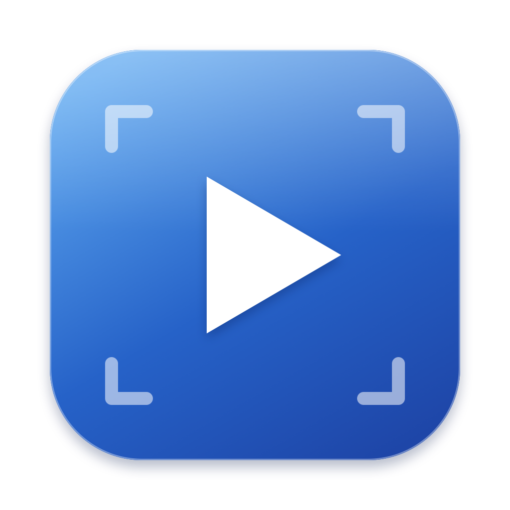
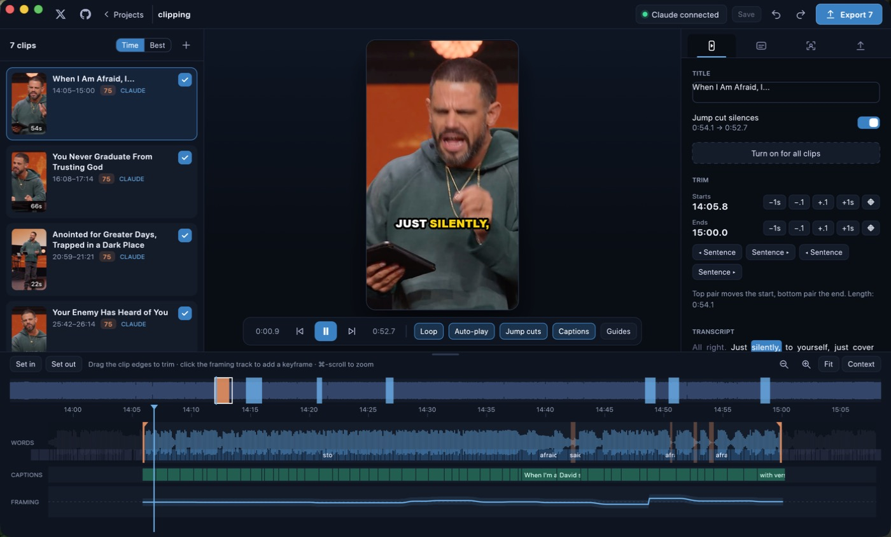
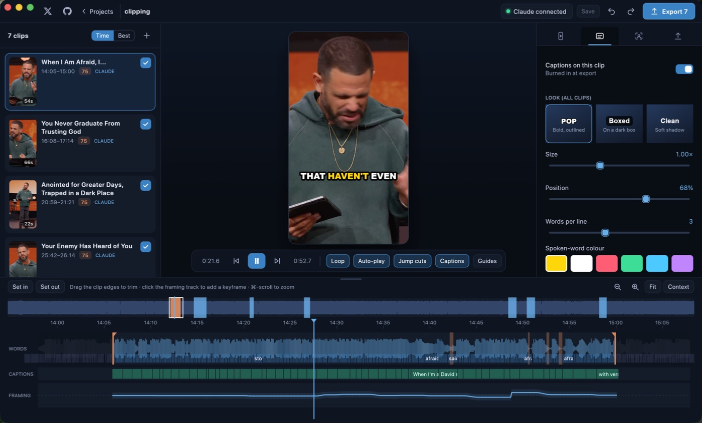
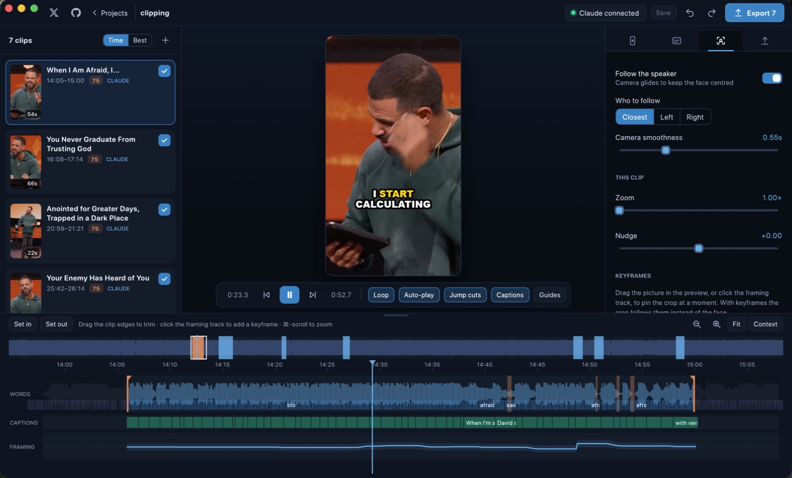
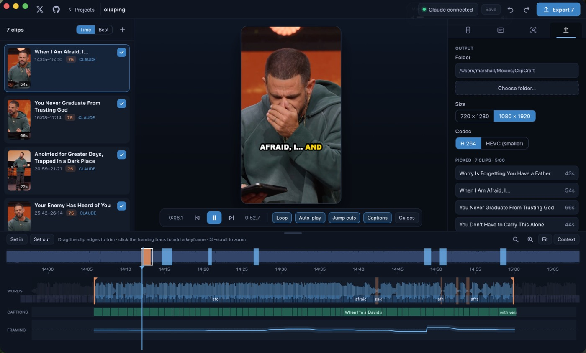
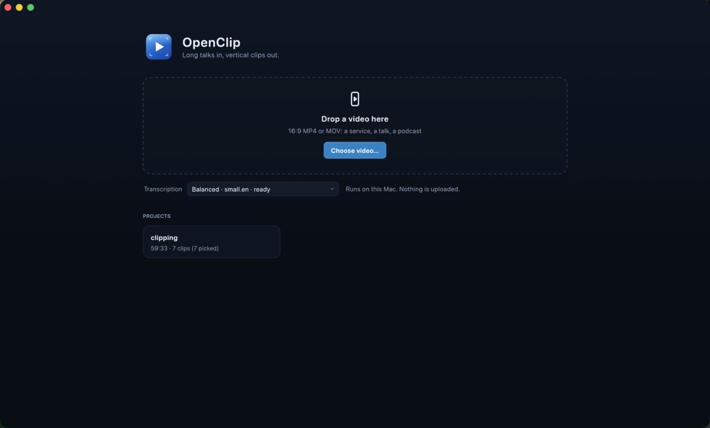

<p align="center">
  
</p>

<h1 align="center">OpenClip</h1>

<p align="center">
  <b>Turn a long 16:9 talk into vertical clips that hit; a fast, native, on-device clip maker built in Rust.</b><br>
  Local whisper.cpp transcription, a face-following 9:16 camera, burned-in captions, and a built-in<br>
  MCP server so Claude can pick the best moments from a few thousand tokens.
</p>

<p align="center">
  
  
  
  
  
  
</p>

<p align="center">
  <a href="https://github.com/MarshallNickolauson/OpenClip/raw/main/OpenClip_0.2.0.dmg"><b>Download for macOS</b></a> ·
  <a href="https://getopenclip.pages.dev">Website</a> ·
  <a href="CHANGELOG.md">Changelog</a>
</p>

<p align="center">
  <a href="#screenshots">Screenshots</a> ·
  <a href="#what-it-does">Features</a> ·
  <a href="#install">Install</a> ·
  <a href="#connect-claude">Connect Claude</a> ·
  <a href="#using-it">Using it</a> ·
  <a href="#shortcuts">Shortcuts</a> ·
  <a href="#how-it-is-built">How it is built</a> ·
  <a href="#development">Development</a> ·
  <a href="#license">License</a>
</p>

<br>

> A sibling of [ScreenCraft](https://github.com/MarshallNickolauson/ScreenCraft): same Rust-first, no-ffmpeg, everything-on-your-Mac approach,
> same editor layout, aimed at a different job: Sunday service in, a dozen shareable shorts out.
> OpenClip was called ClipCraft before 0.2.0.

## Screenshots

The editor, with Claude's suggestions in the list on the left, the 9:16 preview in the middle and the
clip's timeline below. The orange bands on the words track are the silences jump cuts will remove.



Caption looks, size, position and the spoken-word colour:



Framing: who the camera follows, smoothness, zoom, nudge and keyframes:



Export, with the picked clips, size and codec:



The home screen: drop a video, pick a transcription model, reopen a project.



## What it does

Drop in a 30-minute (or 75-minute) 16:9 video. OpenClip transcribes it on your Mac, finds faces while it
does, and lets Claude (or its own scorer) suggest the 5–10 moments that work on their own. Each one is a
9:16 clip centred on the speaker, with captions you can restyle and a timeline you can tune by hand.

**Import**
- MP4 / MOV (H.264 or HEVC). Speech recognition with [whisper.cpp](https://github.com/ggml-org/whisper.cpp)
  on the GPU (Metal), word-level timestamps, three models: Fast (base.en), Balanced (small.en), Best
  (large-v3-turbo). Reuses models already downloaded by ScreenCraft or the old ClipCraft.
- Face tracking with Apple Vision runs in parallel with transcription, across all cores.
- A 75-minute, 2 GB sermon is ready in about 8 minutes on an M-series Mac, and you can start working the
  moment the transcript lands while faces finish in the background.

**Finding clips**
- **Claude over MCP.** `get_candidates` returns ~20 pre-ranked, sentence-aligned moments (a few thousand
  tokens whatever the video length); Claude picks, and `save_clips` drops them into the app live.
- **Quick pick.** A built-in scorer (clean opening, pace, direct address, repetition and music penalties,
  face on screen) that works without Claude.
- Or drag across the overview bar to mark a clip yourself.

**Editing**
- **Framing:** a virtual camera that holds still while the speaker stays centred, glides when they move,
  and cuts when the source cuts between cameras. Choose who to follow (closest / left / right), zoom in,
  nudge, or drag the preview to pin keyframes.
- **Captions:** burned-in Pop, Boxed or Clean looks with the spoken word highlighted; size, position, words
  per line, colour. Fix a word by double-clicking it, hide one with ⌥-click.
- **Timeline per clip:** waveform, words, caption blocks and the framing path. Drag the edges to trim (they
  snap to words), step by sentence, set in/out at the playhead, zoom and scroll.
- **Jump cuts:** one toggle (or T) removes the pauses between sentences, in the preview and the export.
- **Preview** is a real 9:16 player that uses the same camera path as the export, so what you see is what
  you get. Arrow keys move through suggestions and each one autoplays.
- **Unsaved changes** show as `*` after the project name; ⌘S saves, and closing asks first.

**Export**
- Tick the clips you want and export them in one go: 1080×1920 (or 720×1280), H.264 or HEVC, AAC, 30 fps
  max. Hardware encoding through AVFoundation (VideoToolbox), captions drawn with CoreText, no ffmpeg and
  no openh264: only the codecs the operating system itself ships and licenses.

## Install

### macOS

Download [`OpenClip_0.2.0.dmg`](https://github.com/MarshallNickolauson/OpenClip/raw/main/OpenClip_0.2.0.dmg) from the root of this
repository, open it and drag **OpenClip** onto **Applications**. The app is only ad-hoc signed (not
notarised), so the first time you open it use right-click → **Open**.

Requires macOS 13 (Ventura) or newer; developed and tested on Apple silicon.

**Permissions.** OpenClip needs none of the privacy permissions ScreenCraft does (no screen recording,
camera or microphone). macOS may ask once for access to the folder your video lives in (Desktop,
Documents, Downloads or Movies); allow it so the video can be read and clips saved.

### Build from source (macOS)

```bash
git clone https://github.com/MarshallNickolauson/OpenClip.git
cd OpenClip
./scripts/bundle.sh --install     # builds a release app and copies it to ~/Applications
open ~/Applications/OpenClip.app
```

Needs [Rust](https://rustup.rs) (stable), CMake (`brew install cmake`, for whisper.cpp) and the Xcode
command line tools. `./scripts/bundle.sh` without `--install` leaves the app at `dist/OpenClip.app`;
`./scripts/dmg.sh` also builds `OpenClip_<version>.dmg`. The app icon is rendered by `scripts/make-icon.swift`.

## Connect Claude

OpenClip ships a local MCP server (`OpenClip.app/Contents/MacOS/openclip-mcp`). Claude launches it over
stdio on your Mac, so there is nothing to deploy and no account or key.

In the app, click **Claude** in the top bar:

- **Claude Desktop:** *Add to Claude Desktop* merges the server into
  `~/Library/Application Support/Claude/claude_desktop_config.json` (a `.bak` is kept). Restart Claude Desktop.
- **Claude Code:** copy the command shown, which looks like
  `claude mcp add openclip -- "/Applications/OpenClip.app/Contents/MacOS/openclip-mcp"`.

Then ask: *“Find the best clips in my open OpenClip project.”* (There is also a `find_clips` prompt.)

| Tool | What it does |
| --- | --- |
| `get_candidates` | Top pre-ranked moments with their text and sentence ids; skips ones already saved. |
| `get_transcript` | Compact `id m:ss text` lines for a time or sentence range, only when needed. |
| `save_clips` | Saves clips by sentence ids with title and reason; revise one by passing its `id`. |
| `get_clips` | Lists saved clips and which are ticked for export. |
| `list_projects` | Projects on this Mac (rarely needed; the open project is the default). |

Why it is cheap: Claude references sentences by number instead of timestamps, replies in plain text, and
normally makes two calls (`get_candidates`, `save_clips`) for roughly 3–5k tokens in and under 1k out.

## Using it

1. Drop a video on the home screen (or **Choose video…**). Pick a transcription model.
2. When the transcript is ready the editor opens. Click **Claude** and ask for clips, or **Quick pick**.
3. Move through suggestions with **↑ / ↓**; each autoplays in the 9:16 preview. Press **X** to tick the
   ones to export, **⌫** to dismiss.
4. Tune a clip: trim on the timeline, restyle captions, adjust framing, toggle jump cuts.
5. **Export** (⌘E). Files go to `~/Movies/OpenClip` by default.

Projects live in `~/OpenClip Projects/<name>.openclip/` (transcript, faces, loudness, clips). The source
video is referenced, not copied. Projects from the ClipCraft days are moved over automatically.

### Shortcuts

`Space` play / pause · `↑` `↓` / `K` `J` previous / next clip · `←` `→` step 0.5 s (⇧ 5 s) · `X` / `↩` tick for
export · `⌫` dismiss · `[` `]` set in / out at the playhead · `L` loop · `C` captions · `T` jump cuts ·
`Q` restart · `N` new clip · `1`–`4` Clip / Captions / Framing / Export tabs · `⌘Z` / `⇧⌘Z` undo / redo ·
`⌘S` save · `⌘E` export · `⌘`-scroll zoom the timeline

## How it is built

| Piece | Where | What it does |
| --- | --- | --- |
| `openclip-core` | `crates/core` | Pure Rust: project model, word / sentence transcript, moment scoring, face-follow camera, caption chunking and styles, the MCP server. Unit tested. |
| `openclip-mcp` | `crates/core/src/bin` | The stdio MCP binary Claude launches. No GUI, no whisper, starts instantly. |
| App | `app` | A native [egui](https://github.com/emilk/egui) app (eframe + wgpu/Metal), no web view anywhere: whisper pipeline, project IO, editor, timeline, export queue. |
| Native media | `app/native` | Thin Objective-C layer: AVPlayer preview, AVFoundation decode / export, Vision faces, Core Image crop, CoreText captions. |

Some details worth knowing:

- **One camera path.** `camera_path` in the core crate produces the crop centre at 10 Hz; the preview and
  the exporter both interpolate it, so there are no preview / export surprises.
- **The app owns `project.json`.** Claude only writes `suggestions.json`; the app merges it on change, and
  never overwrites a clip you edited.
- **Speech detection for music.** Worship songs score high on repetition and loudness, so the scorer
  penalises repeated phrases and the absence of pauses.
- **Preview** is an `AVPlayer` (hardware decode, audio) whose frames are cropped on the GPU to the camera
  window and shown as an egui texture; there is no `<video>` element and no local web server.
- **OS codecs only.** Encoding goes through AVFoundation / VideoToolbox; nothing like openh264 or ffmpeg is
  linked or bundled.

## Development

```bash
cargo test -p openclip-core            # unit tests
cargo run --release -p openclip                                        # the app
cargo run --release -p openclip -- import ~/talk.mp4 small.en          # headless import
cargo run --release -p openclip -- candidates                          # print local top moments
cargo run --release -p openclip -- export "~/OpenClip Projects/talk.openclip"   # export picked clips
swift scripts/make-icon.swift app/icons/icon-1024.png                  # regenerate the icon
swift scripts/make-ui-icons.swift app/assets/icons                     # regenerate the UI glyphs
./scripts/bundle.sh --install
```

Set `OPENCLIP_HOME` to keep projects somewhere other than `~/OpenClip Projects`.

## License

MIT; see [LICENSE](LICENSE) and [THIRD-PARTY-NOTICES.md](THIRD-PARTY-NOTICES.md) (whisper.cpp, egui and
others). By using this software you agree the authors are not liable for any issues arising from its use.

## Known limitations

- macOS only for now. MP4 / MOV with H.264 or HEVC; other containers need converting first.
- The camera follows the largest face, not the active speaker; use *Left / Right* or keyframes for
  two-person scenes.
- Transcription quality depends on the model and audio; sung passages are transcribed but de-prioritised.
- Export is not real-time (roughly 2–3× on Apple silicon) and runs one clip at a time.
- No code signing or notarisation; macOS will warn on first launch.
- Early alpha: expect rough edges.
